## 1. Introducción

Este documento registra las decisiones metodológicas y los resultados técnicos del proyecto. La definición del problema, los objetivos, las hipótesis y los criterios de éxito están en el documento de negocio (`docs/negocio.md`). Cubre las fases técnicas del proyecto: inventario y selección de fuentes (Fase 1, que consolida el Momento A), limpieza (Fase 3), integración y análisis exploratorio (Fase 4), modelado (Fase 5) y tablero (Fase 6). Cierra con las conclusiones técnicas y las instrucciones de reproducibilidad (Fase 7).

## 2. Entorno de trabajo y organización del proyecto

### 2.1 Estructura de carpetas

| Carpeta o archivo | Contenido |
|-------------------|-----------|
| `data/raw/` | Los tres documentos aceptados, en su forma original. No se versiona. |
| `data/excluded/` | Los tres documentos rechazados en el Momento A. Se conservan pero no se usan. No se versiona. |
| `data/processed/` | Conjuntos limpios e integrados (Fases 3 y 4). No se versiona. |
| `notebooks/` | `00_momento_A`, `00_perfil_aceptados`, `01_limpieza`, `02_eda`, `03_modelado`. |
| `src/` | Código reutilizable: `datos.py` (rutas, carga y perfilado), `diccionario.py` (diccionario de variables), `limpieza.py` y `codificacion.py` (limpieza y reglas de codificación), `integracion.py`, `eda.py`, `graficos.py` y `modelado.py` (integración, pruebas, figuras y agrupamiento), `tablero.py` (indicadores del tablero), `texto.py` (análisis de texto con NLTK), `anexos.py`, `momento_a.py`, `exportar_docs.py`. |
| `app/` | Tablero en Streamlit (`app.py`, Fase 6). |
| `docs/` | Documentos técnico y de negocio en `.md`, `.docx` y `.pdf`; matriz de relación y diccionario de variables en `.csv`. |

### 2.2 Reproducibilidad

El análisis se hace en Python 3.14 dentro de un entorno virtual (`.venv`), con versiones fijadas en `requirements.txt`. Las semillas aleatorias se fijan con `numpy.random.seed(42)`. Los cuadernos se ejecutan completos, sin errores, antes de cada entrega. Los documentos se convierten a Word y PDF con `src/exportar_docs.py`, que usa pandoc. Como el equipo de desarrollo no tiene un motor LaTeX, el PDF se obtiene imprimiendo el HTML generado por pandoc con Microsoft Edge en modo *headless*; si `xelatex` está disponible, el script lo usa automáticamente.

### 2.3 Protección de datos personales

Los cuestionarios contienen números de cuenta y, en algunos casos, correos institucionales. Para protegerlos se tomaron tres medidas:

1. La carpeta `data/` está excluida de Git (`.gitignore`), así que ningún dato crudo o procesado se publica.
2. Los cuadernos solo muestran conteos y estadísticos agregados. Antes de cada commit se verifica que no contengan secuencias de 9 o 10 dígitos.
3. Desde la Fase 3, el número de cuenta se reemplaza por un seudónimo (HMAC-SHA256 con clave secreta en `data/raw/`) antes de guardar los conjuntos procesados.

## 3. Fase 1 — Inventario y selección de fuentes

### 3.1 Inventario inicial

Se recibieron seis cuestionarios aplicados con Google Forms a estudiantes de MAC. El análisis completo de los seis está en `docs/momento_A.pdf` (cuaderno `00_momento_A.ipynb`).

| # | Documento | Registros × variables | Llave | Tema central |
|---|-----------|----------------------|-------|--------------|
| 1 | La música y su influencia en el estado de ánimo | 24 × 18 | Número de cuenta | Hábitos musicales y efecto percibido en el ánimo |
| 2 | Entorno Universitario y Bienestar | 19 × 17 | Número de cuenta | Bienestar: sueño, desánimo, irritabilidad, concentración |
| 3 | Desempeño académico por el uso de IA | 24 × 18 | Número de cuenta | Uso académico de la IA y su efecto en el estrés |
| 4 | Test | 25 × 18 | Correo y número de cuenta | Personalidad y preferencias |
| 5 | Pelis y series | 21 × 17 | Número de cuenta | Preferencias audiovisuales |
| 6 | Relación Amor – Carrera | 21 × 21 | Solo correo | Concepciones de pareja |

### 3.2 Criterios y matriz de relación

Un documento se acepta si contiene variables relacionadas con la pregunta de investigación (música, ánimo, estrés, sueño, concentración o IA) y comparte la llave *número de cuenta* con los demás aceptados. Se rechaza si no cumple el primer criterio, si su llave es incompatible o si su inclusión aporta ruido sin señal.

Los seis cuestionarios fueron respondidos prácticamente por el mismo grupo, así que la llave resultó compatible en todos. La decisión dependió entonces de la pertinencia temática. Para evaluarla de forma verificable, se normalizaron los enunciados de las preguntas y se contaron los que aluden a los constructos de la investigación: 26 en el Documento 1, 16 en el 3, 5 en el 2, 1 en el 6 y ninguno en el 4 ni en el 5.

| Documento | ¿Relación con música, ánimo, estrés o IA? | Llave compatible | Veredicto |
|-----------|------------------------------------------|------------------|-----------|
| 1. Música y ánimo | Sí, directa | Sí | **Aceptar (principal)** |
| 2. Entorno universitario y bienestar | Sí: ánimo, sueño, concentración y estrés indirecto | Sí | **Aceptar (complementario fuerte)** |
| 3. Desempeño por uso de IA | Sí: IA y estrés académico | Sí | **Aceptar (complementario medio)** |
| 4. Test | Marginal | Sí, con un duplicado | **Rechazar** |
| 5. Pelis y series | No | Sí | **Rechazar** |
| 6. Relación amor–carrera | No | Solo derivada del correo | **Rechazar** |

La matriz completa, con temas y variables clave, está en `docs/matriz_relacion.csv`.

### 3.3 Justificación

La pregunta de investigación tiene tres componentes: hábitos musicales y ánimo, estrés y sueño, y uso de IA. El Documento 1 es el único que mide la variable central (los hábitos musicales) y el cambio de ánimo atribuido a la música. El Documento 2 mide el bienestar sin hacer referencia a la música, lo que permite contrastar dos fuentes de auto-reporte. El Documento 3 aporta la variable moderadora. Los documentos rechazados no cubren ninguno de los tres componentes. Integrarlos no aumentaría la muestra, que seguiría siendo de 19 registros, y sí agregaría unas cincuenta variables de texto sin relación con la pregunta.

### 3.4 Perfil de los documentos aceptados

Los tres documentos aceptados se trasladaron a `data/raw/` sin modificaciones y se perfilaron con `pandas` (cuaderno `00_perfil_aceptados.ipynb`).

| Indicador | Doc 1. Música | Doc 2. Bienestar | Doc 3. IA |
|-----------|-------------:|-----------------:|----------:|
| Registros | 24 | 19 | 24 |
| Variables | 18 | 17 | 18 |
| Variables de contenido (sin fecha ni cuenta) | 16 | 15 | 16 |
| Variables de contenido con más de 80 % de valores únicos | 16 | 11 | 16 |
| Longitud media de respuesta (palabras) | 10.0 | 4.6 | 11.3 |
| Celdas vacías | 1 | 0 | 2 |
| Filas duplicadas | 0 | 0 | 0 |
| Cuentas duplicadas | 0 | 0 | 0 |
| Cuentas con longitud distinta de 9 dígitos | 1 | 0 | 0 |
| Periodo de recolección | 29 oct – 11 nov 2026 | 1 – 3 nov 2026 | 30 oct – 11 nov 2026 |
| Estudiantes en el núcleo 1 ∩ 2 ∩ 3 | 19 | 19 | 19 |

Los datos tienen buena integridad estructural: no hay duplicados y los faltantes son mínimos (tres celdas en total). La dificultad principal está en la **forma de las respuestas**: 43 de las 47 variables de contenido tienen una redacción distinta en más del 80 % de los casos. Incluso las variables conceptualmente numéricas, como las horas de escucha, las horas de uso de IA, la edad o el tiempo de traslado, se capturaron como texto. El Documento 2 tiene respuestas más breves (4.6 palabras en promedio), lo que facilitará codificarlo en escalas ordinales.

La integración por intersección conservará 19 estudiantes. Se perderán 5 registros del Documento 1 y 5 del Documento 3, todos por no haber respondido el Documento 2; uno de los del Documento 1 es, además, el de la cuenta con formato inválido. Los Documentos 1 y 3 comparten 23 estudiantes, por lo que los análisis que solo involucren música e IA podrán usar una muestra mayor.

### 3.5 Diccionario de variables

A cada columna se le asignó un nombre corto con prefijo por documento (`m_` música, `b_` bienestar, `ia_` inteligencia artificial), una forma de respuesta, una codificación prevista para la Fase 3 y un uso analítico. El renombrado se aplica por posición y la función de carga (`src/datos.py::cargar`) verifica que el número de columnas coincida con el diccionario, para evitar asignaciones silenciosas incorrectas.

| Forma de respuesta | Doc 1 | Doc 2 | Doc 3 | Total |
|--------------------|------:|------:|------:|------:|
| Texto libre | 6 | 1 | 9 | 16 |
| Ordinal en texto | 4 | 7 | 0 | 11 |
| Numérica en texto | 1 | 3 | 2 | 6 |
| Multirrespuesta en texto | 3 | 0 | 2 | 5 |
| Categórica en texto | 0 | 2 | 1 | 3 |
| Sí/No con explicación | 1 | 0 | 2 | 3 |
| Likert en texto | 0 | 2 | 0 | 2 |
| Lista en texto | 1 | 0 | 0 | 1 |
| **Total** | **16** | **15** | **16** | **47** |

Las hipótesis quedan operacionalizadas con las siguientes variables:

| Hipótesis | Variables |
|-----------|-----------|
| H1. Mejora de ánimo con música y menor desánimo e irritabilidad | `m_animo_antes_despues`, `m_maneja_emociones`, `b_desanimo`, `b_irritabilidad` |
| H2. Horas y momentos de escucha frente a ánimo, concentración y sueño | `m_horas_dia`, `m_momentos`, `m_energia`, `m_concentracion`, `m_sueno`, `b_sueno_calidad`, `b_concentracion_dif` |
| H3. Géneros musicales y estados positivos | `m_genero_frecuente`, `m_generos_emocion` |
| H4. Moderación por uso de IA | `m_animo_antes_despues`, `ia_horas_dia`, `ia_guia_vs_atajo`, `ia_estres`, `ia_independencia` |

Cuatro variables de texto libre sin papel en las hipótesis no se codificarán: artistas favoritos, cambio en la forma de estudiar, proceso de verificación de la información y reglas personales de uso de la IA. Se analizan de forma descriptiva con NLTK en la Fase 4 (sección 5.7). El diccionario completo está en el Anexo A y en `docs/diccionario_variables.csv`.

### 3.6 Criterio de aceptación de la fase

- [x] Matriz de relación y justificación de la selección documentadas (secciones 3.2 y 3.3).
- [x] Los tres documentos aceptados se leen y perfilan con `pandas` mediante funciones reutilizables (`src/datos.py`).
- [x] Datos crudos organizados en `data/raw/` y protegidos de Git.
- [x] Diccionario de variables con regla de codificación y uso para cada pregunta.

## 4. Fase 3 — Limpieza individual

### 4.1 Objetivo y principios

El objetivo de esta fase es depurar por separado cada documento aceptado y convertir sus respuestas abiertas en variables analizables, sin integrarlos todavía. El procedimiento está en `notebooks/01_limpieza.ipynb`, y las reglas en `src/limpieza.py` (funciones generales) y `src/codificacion.py` (reglas por documento). Se siguieron cuatro principios:

1. **Reglas explícitas.** Cada variable se codifica con una lista ordenada de expresiones regulares sobre texto normalizado. La primera regla que coincide asigna el valor, y las más específicas (negaciones, matices) van primero.
2. **No inventar datos.** Si una respuesta no permite asignar un valor sin suponer información, se registra como faltante. No se imputa ningún valor.
3. **Marcar en lugar de eliminar.** Los atípicos y las respuestas sospechosas se señalan con banderas, para que su exclusión sea una decisión explícita del análisis.
4. **Validación exhaustiva.** Antes de fijar las reglas, se revisó cada respuesta junto a su código asignado. Esta revisión llevó a corregir tres reglas antes de la versión final: una errata en el nombre de la carrera, una negación interna en la pregunta de alimentación y una errata en "desayunar".

### 4.2 Procedimiento común

- **Normalización.** Descomposición Unicode NFKD, eliminación de diacríticos, minúsculas y unificación de espacios y saltos de línea (`unicodedata`, `re`).
- **Estandarización de duraciones.** Los números escritos se convierten a dígitos ("una", "veinticuatro", "media"). Además: un rango se resume en su punto medio ("2-3 h" → 2.5); "x o más" se toma como x, su cota inferior; "menos de 1" vale 0.5; los minutos se convierten a fracción de hora.
- **Escalas ordinales y Likert.** Las expresiones verbales se ubican en escalas de 0 a 4, 0 a 3, 0 a 2 o −1 a 1, según la variable. Las calificaciones x/10 se reescalan a la escala correspondiente.
- **Llave y anonimato.** La cuenta de 10 dígitos del Documento 1 se corrigió porque, al borrar un dígito, coincidía de forma única con la cuenta sin pareja del Documento 3. Después, el número de cuenta se sustituyó por un seudónimo: HMAC-SHA256 con una clave secreta guardada fuera de Git, truncado a 12 caracteres. El seudónimo es el mismo en los tres documentos e irreversible sin la clave.

### 4.3 Resultados por documento

| Indicador | Doc 1. Música | Doc 2. Bienestar | Doc 3. IA |
|-----------|-------------:|-----------------:|----------:|
| Registros conservados | 24 de 24 | 19 de 19 | 24 de 24 |
| Variables en el archivo limpio | 53 | 37 | 45 |
| Variables derivadas (codificadas, banderas y calidad) | 35 | 20 | 27 |
| Faltantes de origen | 1 | 0 | 2 |
| Archivo | `doc1_musica_clean.csv` | `doc2_bienestar_clean.csv` | `doc3_ia_clean.csv` |

No se eliminó ningún registro. La lista de variables derivadas, con sus válidos y faltantes, está en `docs/variables_codificadas.csv`.

**Distribuciones de las variables clave:**

| Variable | Válidos | Distribución |
|----------|--------:|--------------|
| `mejora_animo` (Doc 1) | 20 | Mejora: 17 · Sin cambio: 3 |
| `m_horas` (Doc 1) | 24 | Mediana 4 h (Q1 2.4 · Q3 5.5); mín. 0, máx. 15 |
| `m_horas_nivel` (Doc 1) | 24 | Baja: 5 · Media: 9 · Alta: 10 |
| `m_genero_grupo` (Doc 1) | 24 | Rock/metal: 8 · Pop: 6 · Electrónica: 3 · Urbano: 3 · Regional: 2 · Variado: 1 · No escucha: 1 |
| `m_concentracion_cod` (Doc 1) | 23 | Distrae: 7 · Depende: 5 · Ayuda: 11 |
| `iep` (Doc 2) | 18 | Bajo: 4 · Medio: 9 · Alto: 5 |
| `b_sueno_calidad_cod` (Doc 2) | 19 | Mala: 5 · Algo mala: 6 · Regular: 5 · Buena: 3 |
| `ia_horas` (Doc 3) | 24 | Mediana 1.5 h (Q1 1 · Q3 2); mín. 0.08, máx. 8 |
| `ia_guia_vs_atajo_cod` (Doc 3) | 23 | Guía: 8 · Ambas: 13 · Atajo: 2 |
| `ia_estres_cod` (Doc 3) | 24 | Aumenta: 1 · Sin efecto: 3 · Disminuye: 20 |

**Faltantes generados por la codificación.** Las respuestas que describen un estado sin comparar el antes y el después no se cuentan como mejora de ánimo: "bueno", "muy bueno" y "mejorable" (4 casos). Tampoco se codificaron:

- una frecuencia de desánimo sin periodo ("5 veces"), por lo que ese estudiante no tiene IEP;
- dos niveles de interés sin escala ("4" y "se sigue manteniendo estable");
- una carrera no especificada ("UNAM");
- algunas respuestas sobre la IA sin dirección clara (entre 1 y 5 por variable).

### 4.4 Valores atípicos

Se aplicó el criterio del rango intercuartílico (fuera de Q1 − 1.5·IQR o de Q3 + 1.5·IQR):

| Variable | Límite superior | Valores atípicos |
|----------|----------------:|------------------|
| `m_horas` | 10.2 h | 15 h |
| `b_traslado_min_cod` | 135 min | 360 min |
| `ia_horas` | 3.5 h | 4, 6 y 8 h (la de 8 h incluye uso en el trabajo) |
| `b_edad_cod` | 26 años | ninguno |

Ningún atípico se eliminó. Son auto-reportes posibles, por ejemplo música de fondo durante toda la jornada o un traslado excepcionalmente largo. Los indicadores reportarán la mediana junto con la media.

### 4.5 Respuestas copiadas

Para cada estudiante se contaron las respuestas abiertas de al menos cinco palabras idénticas a la de otro estudiante. Un registro del Documento 3 tiene 4 coincidencias de este tipo y comparte seudónimo con un registro del Documento 1. Ese estudiante quedó marcado con `sospecha_copia = 1` y se conservó. No pertenece al núcleo de 19, así que solo afectará los análisis que usen los Documentos 1 y 3 sin el 2; para esos se reportará un análisis de sensibilidad.

### 4.6 Implicaciones para las fases siguientes

1. **El modelado supervisado no es viable con la etiqueta prevista.** `mejora_animo` tiene solo 3 casos negativos, menos que el mínimo de 4 fijado en `docs/negocio.md` §5. La Fase 5 se centrará en el agrupamiento no supervisado, y el KPI 1 deberá leerse junto con su *n*.
2. **`ia_estres_cod` está muy concentrada** (20 de 24 casos en "disminuye"), así que tendrá poco poder para distinguir grupos. Para H4 tendrán más peso las horas de IA y la modalidad de uso.
3. **La categoría "atajo" tiene 2 casos.** En los indicadores se agrupará con "ambas", conforme a la regla de mínimo 3 casos.
4. **El semestre es constante (7 en los 19 casos)**, lo que confirma que el filtro por semestre del tablero solo tendrá valor si se agregan datos de otros semestres.

### 4.7 Criterio de aceptación de la fase

- [x] Diagnóstico de forma, tipos, faltantes y duplicados para cada documento.
- [x] Texto normalizado (NFKD, `re`) y respuestas Likert y ordinales codificadas con reglas documentadas.
- [x] Horas y minutos estandarizados con expresiones regulares y `apply`/`map`.
- [x] Faltantes tratados con justificación y sin imputación; atípicos detectados y marcados.
- [x] Conjuntos guardados en `data/processed/` con sufijo `_clean`, sin números de cuenta.
- [x] Bitácora de decisiones en el cuaderno (sección 9).

## 5. Fase 4 — Integración y análisis exploratorio

El procedimiento completo está en `notebooks/02_eda.ipynb`; las funciones, en `src/integracion.py`, `src/eda.py` y `src/graficos.py`. La tabla con todas las pruebas está en `docs/pruebas_hipotesis.csv`.

### 5.1 Decisiones metodológicas

- **Pruebas.** Se usaron pruebas no paramétricas o exactas, adecuadas para muestras de 16 a 24 casos y variables ordinales: Spearman, Mann-Whitney U, Kruskal-Wallis, Fisher exacta y ji-cuadrada (esta última solo descriptiva, por las celdas esperadas pequeñas).
- **Tamaño de efecto.** Toda prueba reporta uno: ρ, correlación biserial de rangos r, razón de momios (OR) o ε².
- **Comparaciones múltiples.** Se aplicó la corrección de Benjamini-Hochberg sobre las 23 pruebas de hipótesis. Un resultado con *p* < 0.05 y *q* ≥ 0.05 se reporta como **señal exploratoria**.
- **Sensibilidad.** Las señales se repitieron sin valores atípicos y sin el registro marcado como posible copia.
- **Interpretación.** Ningún resultado se interpreta de forma causal.

### 5.2 Integración

| Conjunto | Documentos | Registros | Pérdidas |
|----------|-----------|----------:|----------|
| Núcleo integrado (`integrado_123.csv`) | 1 + 2 + 3 | **19** | 5 del Doc 1 y 5 del Doc 3 (no respondieron el Doc 2) |
| Música + IA (`integrado_13.csv`) | 1 + 3 | **24** | Ninguna, gracias a la corrección de la cuenta en la Fase 3 |

La unión se hizo por seudónimo, con unión interna y validación uno a uno. Los 5 registros del Documento 1 que no entran al núcleo no difieren de los conservados en horas de escucha (*p* = 0.19) ni en mejora de ánimo (*p* = 1.0). No se detecta un sesgo de selección evidente, aunque la prueba tiene poca potencia.

### 5.3 EDA individual

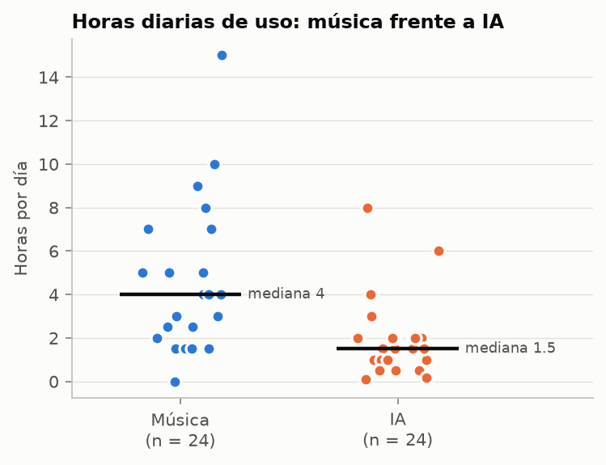

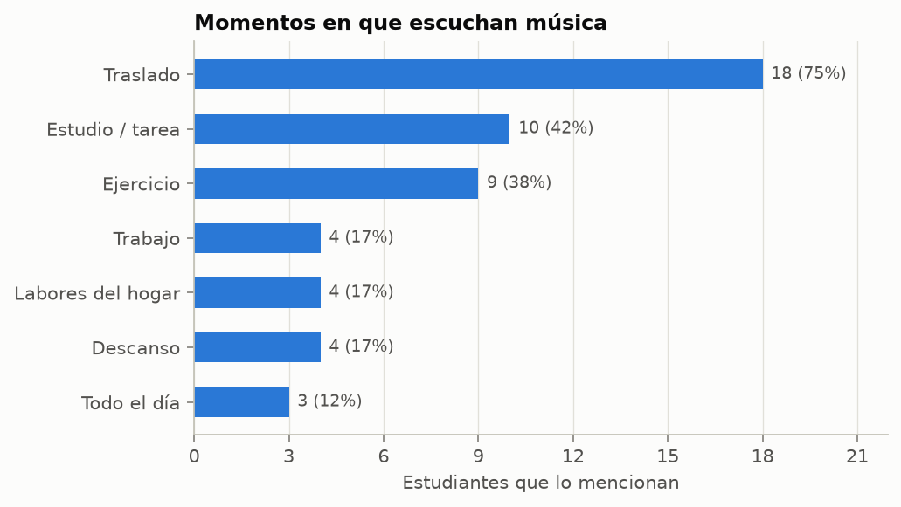

- **Hábitos musicales.** Los estudiantes escuchan música una mediana de **4 horas diarias** (rango de 0 a 15). El momento más frecuente es el **traslado** (75 %), seguido del estudio (42 %) y el ejercicio (38 %). Los géneros principales más comunes son rock/metal (8) y pop (6). La plataforma más usada es YouTube (13), seguida de Spotify (11).
- **Bienestar** (núcleo, n = 19):
  - el desánimo tiene mediana 3 en la escala de 0 a 4, y 7 de 18 lo reportan casi siempre;
  - 11 de 19 califican su sueño como malo o algo malo;
  - **14 de 18 tienen un IEP medio o alto**;
  - el apoyo social es alto (mediana 3 de 3).
- **IA** (n = 24):
  - mediana de **1.5 horas diarias**;
  - las herramientas más usadas son Gemini (15) y ChatGPT (11);
  - 13 de 23 la usan como guía y como atajo, 8 solo como guía y 2 solo como atajo;
  - 20 de 24 perciben que reduce su estrés.

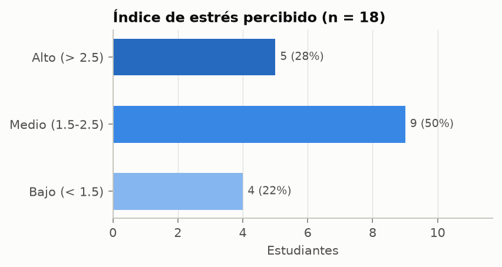

### 5.4 Correlaciones

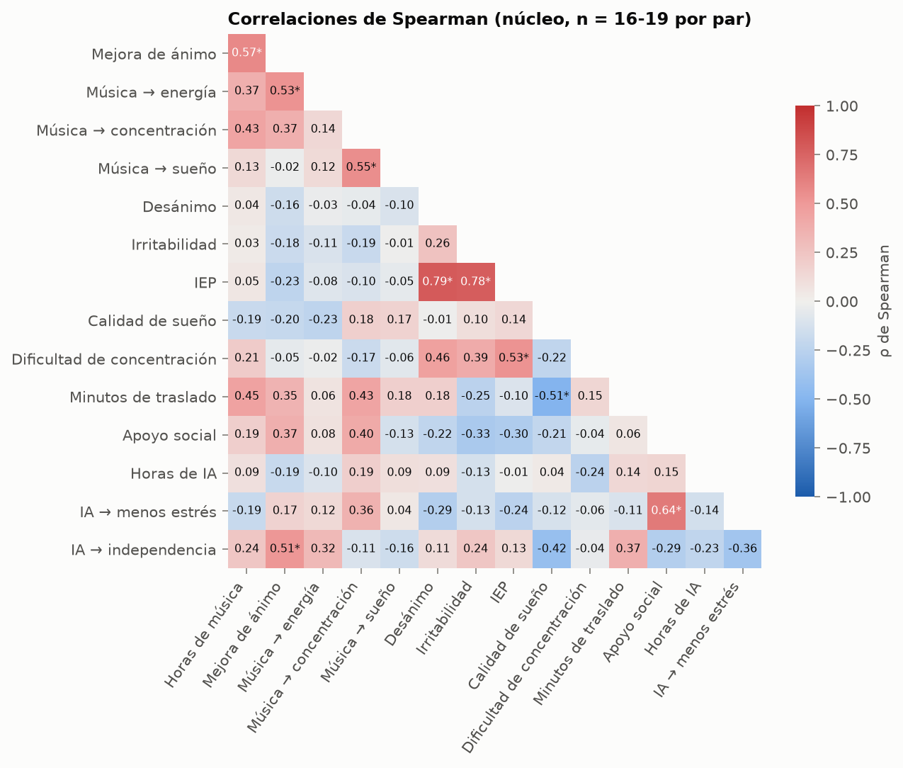

Patrones principales:

1. El IEP se asocia con la dificultad de concentración (ρ = 0.53), lo que respalda su coherencia como indicador indirecto.
2. **A más minutos de traslado, peor calidad de sueño** (ρ = −0.51, *p* = 0.027). Esto da sustento empírico a un elemento de la problemática.
3. Las horas de música se asocian con reportar mejora de ánimo (ρ = 0.57) y con percibir que la música ayuda a concentrarse (ρ = 0.43).
4. Quienes tienen más apoyo social perciben con más fuerza que la IA reduce su estrés (ρ = 0.64, *p* = 0.003). Es un hallazgo no anticipado que conviene confirmar.
5. **Ninguna variable de música se correlaciona con los indicadores generales de bienestar del Documento 2** (|ρ| ≤ 0.23).

Con 105 pares evaluados, unos 5 resultados con *p* < 0.05 serían esperables solo por azar; por eso los patrones son orientativos.

### 5.5 EDA comparado: evaluación de hipótesis

| Hipótesis | Pruebas | *p* < 0.05 | *q* < 0.05 | Resultado principal |
|-----------|--------:|-----------:|-----------:|---------------------|
| H1. Mejora de ánimo y menor estrés | 5 | 0 | 0 | Quienes reportan mejora tienen un IEP ligeramente menor (mediana 2.0 frente a 2.5; r = −0.33; *p* = 0.41). Solo hay 3 casos sin mejora |
| H2. Horas y momentos de escucha | 9 | 1 | 0 | Quienes reportan mejora escuchan más horas: 5 frente a 1.5 h; r = 0.88; *p* = 0.019; *q* = 0.35; se mantiene sin atípicos (*p* = 0.021). Los momentos de escucha no se asocian con la mejora |
| H3. Géneros y bienestar | 4 | 0 | 0 | Sin diferencias de IEP ni de mejora entre géneros |
| H4. Moderación por uso de IA | 5 | 1 | 0 | Quienes usan la IA **como guía** tienen un IEP menor: 1.0 frente a 2.5; r = −0.68; *p* = 0.031; *q* = 0.35; se mantiene sin atípicos (*p* = 0.037). Las horas de IA no se asocian con el IEP (ρ = −0.01) |

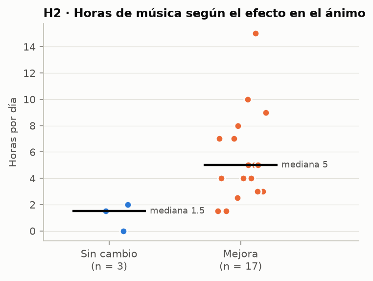

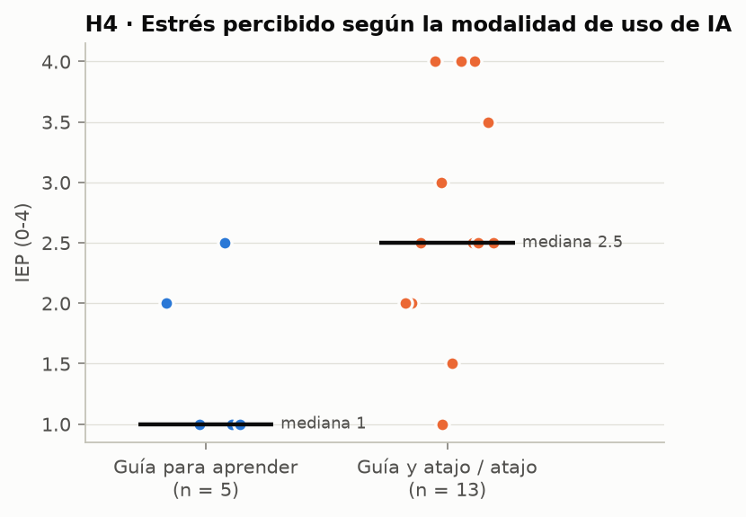

**Moderación exploratoria.** Al dividir el núcleo por la mediana de horas de IA (1.5 h), la relación entre horas de música e IEP cambia de signo: ρ = +0.36 con poco uso de IA (n = 11) y ρ = −0.57 con mucho uso (n = 7). Ninguna de las dos es significativa, y la pendiente del primer grupo depende en buena parte de un estudiante con 15 horas de música. Es una pista descriptiva, no una prueba de interacción.

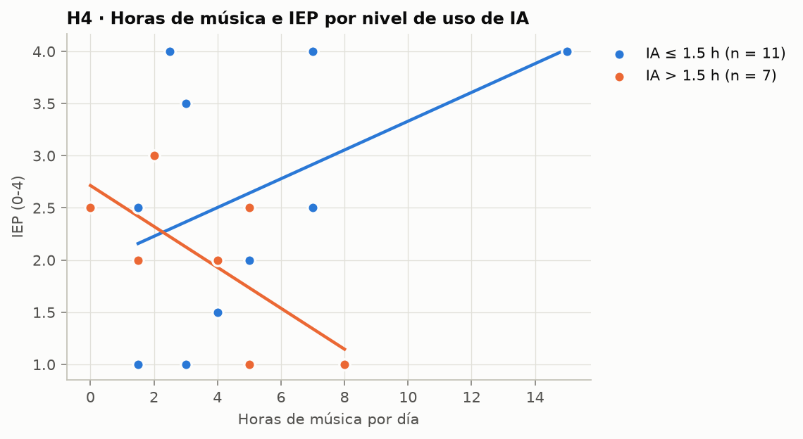

**Análisis complementario (Documentos 1 y 3, n = 24).** No hay relación entre las horas de música y las de IA (ρ = 0.08), ni entre la modalidad de uso de IA y la mejora de ánimo (*p* = 0.52). Excluir el registro marcado como posible copia no cambia ningún resultado.

### 5.6 Valores preliminares de los indicadores

| KPI | Valor preliminar |
|-----|------------------|
| 1. % que reporta mejora de ánimo con música | **85 %** (17 de 20) |
| 2. Horas de escucha por perfil | Baja: mediana 1.5 h (n = 5) · Media: 3 h (n = 9) · Alta: 7 h (n = 10) |
| 3. Géneros con n ≥ 3 en el núcleo | Urbano: 100 % de mejora, IEP medio 2.2 (n = 3) · Pop: 83 %, 2.7 (n = 6) · Rock/metal: 67 %, 2.5 (n = 4) |
| 4. IEP por perfil de horas | Baja: 2.1 · Media: 2.5 · Alta: 2.4 (mediana 2.5 en los tres; Kruskal-Wallis *p* = 0.87) |
| 5. Uso de IA por nivel de IEP | Bajo: 75 % la usa como guía (n = 4) · Medio: 22 % (n = 9) · Alto: 0 % (n = 5); mediana de horas de IA de 1.25 a 1.5 h en los tres niveles |

### 5.7 Análisis descriptivo de texto libre

Las preguntas abiertas que no se codificaron se resumieron con **NLTK**:

1. Normalización del texto.
2. Tokenización con `RegexpTokenizer` (palabras de 3 o más letras).
3. Eliminación de palabras vacías con una lista propia en español, para no depender de descargar corpus externos.
4. Conteo de frecuencias con `FreqDist` y de bigramas.

Se reportan los términos que aparecen al menos 2 veces y en cuántas respuestas aparece cada uno. La figura se elaboró con **seaborn**, con la misma paleta que el resto del documento.

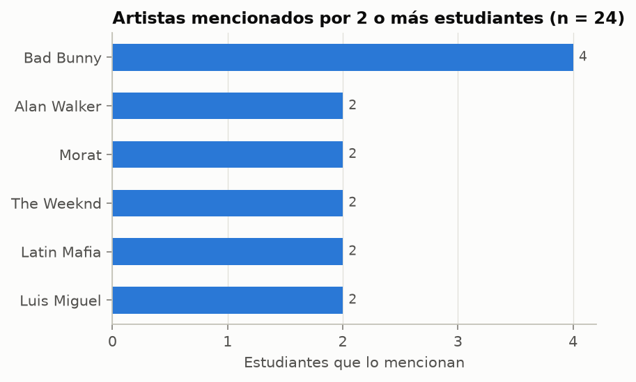

| Pregunta | Términos y bigramas más frecuentes | Lectura |
|----------|------------------------------------|---------|
| Artistas favoritos | Bad Bunny (4); Alan Walker, Morat, The Weeknd, Latin Mafia y Luis Miguel (2 cada uno) | Gustos muy diversos, coherentes con la variedad de géneros |
| Experiencia en que una canción cambió el ánimo | "música", "canción", "pongo", "motiva", "ejercicio" | Uso **deliberado** de la música para activarse |
| Verificación de la información de la IA | "información", "fuentes", "comparo"; bigramas "comparo información" (3) y "fuentes confiables" (2) | La verificación más común es contrastar con otras fuentes |
| Cambio en la forma de estudiar con IA | "estudiar", "entender", "mejor", "temas", "rápido"; bigrama "entender mejor" (3) | La IA se describe como apoyo para comprender y como forma de ahorrar tiempo |

Estos patrones coinciden con los hallazgos cuantitativos: la música se usa de forma funcional y la IA se valora sobre todo como apoyo para comprender. El análisis es descriptivo y no forma parte de la evaluación de hipótesis.

### 5.8 Hallazgos e implicaciones

1. **El beneficio de la música se percibe, pero no se refleja en el bienestar general.** El 85 % atribuye a la música una mejora de ánimo, y ese beneficio crece con las horas de escucha. Sin embargo, los indicadores de bienestar del Documento 2 no varían con los hábitos musicales. La lectura más coherente es que el efecto percibido es **situacional e inmediato**, como acompañar un traslado o una tarea, y no un rasgo del estado de ánimo general.
2. **La modalidad de uso de IA importa más que la cantidad.** Usar la IA como guía para aprender va con menos estrés percibido; las horas de uso no. Es la señal más robusta del estudio, aunque no supera la corrección por comparaciones múltiples.
3. **Los traslados largos se asocian con peor sueño**, lo que respalda la problemática planteada.
4. **Implicaciones para la Fase 5.** No hay base para un modelo supervisado: la etiqueta está desbalanceada (17 frente a 3) y no hay asociaciones robustas. El agrupamiento deberá combinar variables de hábitos musicales (horas, beneficios percibidos), de bienestar (IEP, sueño, concentración) y de IA (horas, modalidad) para explorar perfiles, validando su estabilidad con el coeficiente de silueta.

**Limitaciones.** La muestra es pequeña (potencia suficiente solo para efectos grandes). Los datos son auto-reportados y transversales. La codificación del texto libre implica decisiones del equipo. El IEP no es un instrumento validado. La etiqueta de mejora tiene poca variabilidad.

### 5.9 Criterio de aceptación de la fase

- [x] Unión interna por seudónimo de los Documentos 1, 2 y 3, con registros conservados y perdidos reportados.
- [x] EDA individual: univariado, bivariado y correlaciones (Spearman, ji-cuadrada y Fisher), con visualizaciones.
- [x] EDA comparado: ánimo frente a estrés y sueño, y ánimo frente a uso de IA.
- [x] Hallazgos documentados en este documento y cuaderno ejecutado sin errores.

## 6. Fase 5 — Modelado

El procedimiento está en `notebooks/03_modelado.ipynb` y las funciones en `src/modelado.py`. Las asignaciones de perfil se guardan en `data/processed/perfiles.csv` (seudónimo, perfil y coordenadas PCA).

### 6.1 Modelo supervisado: no viable

La Fase 0 condicionó el modelo supervisado a que la etiqueta `mejora_animo` tuviera al menos 4 casos en la clase minoritaria y a que el modelo superara la línea base. La etiqueta tiene **3 casos negativos**, tanto en el Documento 1 (n = 20) como en el núcleo (n = 17). Predecir siempre "mejora" ya acierta el 85 % y el 82 % de las veces, respectivamente. Con 3 casos, la validación cruzada estratificada admite como máximo 3 particiones, cada una con un solo caso negativo de prueba, así que el F1 de esa clase se movería en saltos de un tercio. Además, el EDA no encontró asociaciones robustas con la etiqueta. **Por estas razones no se entrenó un clasificador**: sus métricas serían engañosas. El análisis continuó con el enfoque no supervisado, que la Fase 0 definió como primera opción.

### 6.2 Diseño del modelo no supervisado

| Decisión | Elección | Justificación |
|----------|----------|---------------|
| Casos | 17 del núcleo con datos completos | No se imputa (Fase 3); se excluyen 2 casos con un faltante cada uno |
| Variables (elegidas *a priori*) | Horas de música, música → energía, música → concentración, IEP, horas de IA, uso de IA como guía | Dos variables por bloque de la pregunta (música, estrés, IA) |
| Validación externa | Calidad de sueño, dificultad de concentración, minutos de traslado, apoyo social, mejora de ánimo | No entran al modelo; desánimo e irritabilidad se excluyen porque forman el IEP |
| Preprocesamiento | `log1p` en horas y estandarización z | Reduce el peso de los valores extremos (15 h de música y 8 h de IA) |
| Algoritmos | K-Means (`n_init` = 50), contrastado con Ward y DBSCAN | Partición principal más dos métodos de contraste |
| Selección de k | Silueta (principal), Davies-Bouldin, Calinski-Harabasz e inercia | Referencia de silueta ≥ 0.25 (`docs/negocio.md` §7) |
| Reproducibilidad | `numpy.random.seed(42)` y `random_state=42` | — |

### 6.3 Selección del número de perfiles

| k | Silueta | Davies-Bouldin | Calinski-Harabasz | Tamaños | ARI frente a Ward |
|--:|--------:|---------------:|------------------:|---------|------------------:|
| 2 | 0.259 | 1.28 | 6.31 | 12, 5 | 1.00 |
| **3** | **0.280** | 1.21 | **6.81** | 6, 6, 5 | 1.00 |
| 4 | 0.265 | 0.94 | 6.64 | 6, 5, 4, 2 | 1.00 |
| 5 | 0.250 | 0.96 | 6.11 | 6, 4, 3, 2, 2 | 1.00 |
| 6 | 0.222 | 0.86 | 5.92 | 5, 4, 3, 2, 2, 1 | 1.00 |

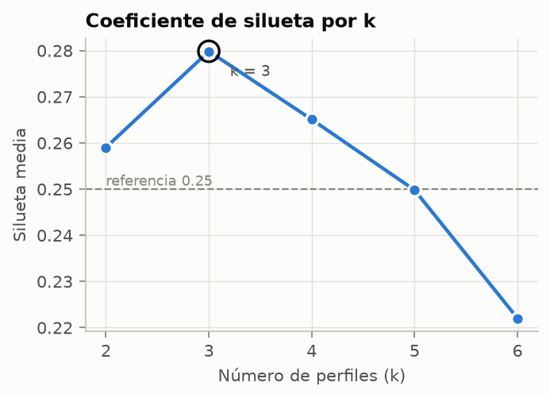

Se eligió **k = 3**. Tiene la mayor silueta y el mayor índice de Calinski-Harabasz, ningún caso con silueta negativa y grupos de tamaño equilibrado. En 200 remuestras bootstrap, su estabilidad es moderada (ARI medio de 0.74, percentil 10 de 0.41). La opción k = 2 tiene mediana 1.0, pero en el 10 % de las remuestras se reorganiza por completo.

### 6.4 Perfiles identificados

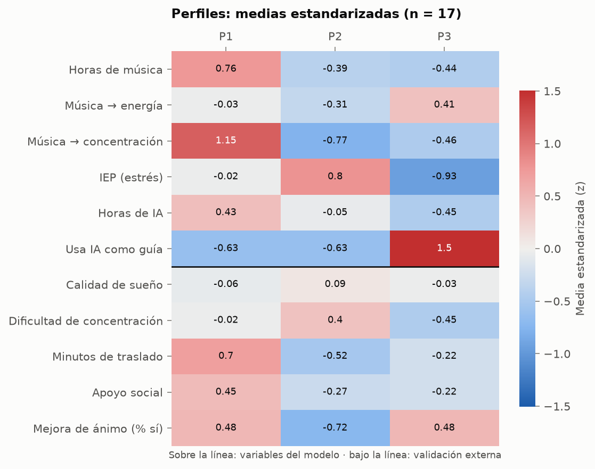

| Perfil | n | Rasgos que lo definen (medianas) | Validación externa |
|--------|--:|----------------------------------|--------------------|
| **P1 · Escucha intensiva** | 6 | 5 h de música; percibe que la música le ayuda a concentrarse; IEP 2.25 (medio); usa la IA como guía y atajo (1.5 h) | Traslados más largos (90 min); mejora de ánimo en el 100 % |
| **P2 · Estrés alto** | 6 | IEP 3.25 (alto); 2.25 h de música; percibe que la música lo distrae al estudiar; usa la IA como guía y atajo | Traslados más cortos (35 min); más dificultad de concentración; mejora de ánimo en el 50 % |
| **P3 · IA como guía, estrés bajo** | 5 | Usa la IA como guía para aprender (0.5 h); 1.5 h de música, que le da energía; IEP 1.0 (bajo) | Mejora de ánimo en el 100 % |

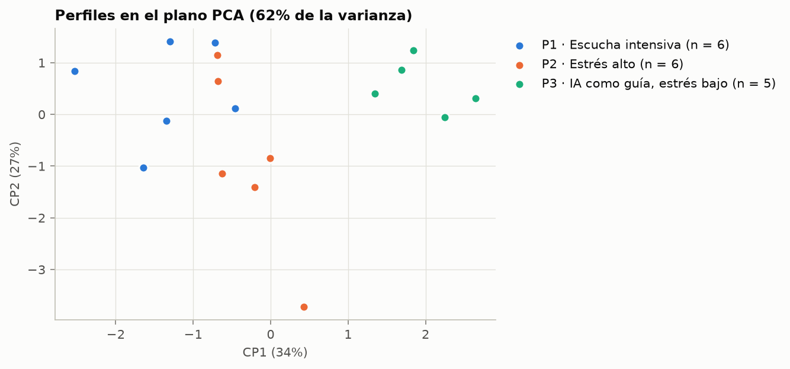

La primera componente (34 % de la varianza) opone el uso de la IA como guía (carga +0.61) al estrés, las horas de música y la concentración atribuida a la música (−0.38 a −0.45): es el eje que aísla al perfil P3. La segunda componente (27 %) recoge la intensidad de escucha y la energía que aporta la música (+0.53 y +0.66) frente a las horas de IA (−0.40), y separa a P1 de P2.

**Validación externa** (Kruskal-Wallis entre perfiles, en variables no usadas por el modelo):

| Variable | *p* | *q* | ε² |
|----------|----:|----:|---:|
| Minutos de traslado | 0.011 | 0.052 | 0.57 |
| Mejora de ánimo | 0.072 | 0.181 | 0.38 |
| Apoyo social | 0.252 | 0.390 | 0.17 |
| Dificultad de concentración | 0.312 | 0.390 | 0.15 |
| Calidad de sueño | 0.935 | 0.935 | 0.01 |

Los perfiles difieren de forma apreciable en el tiempo de traslado y en la mejora de ánimo, que no se usaron para formarlos. No difieren en calidad de sueño.

### 6.5 Contrastes y sensibilidad

- **DBSCAN** (`min_samples` = 3). No encuentra grupos densos. Con `eps` ≤ 1.6 todos los casos quedan como ruido y con `eps` = 3.0 forman un solo grupo. En el punto intermedio (`eps` = 2.5) separa grupos de 11 y 5 casos, que coinciden solo parcialmente con K-Means (ARI = 0.48).
- **Modelo ampliado (8 variables, añadiendo sueño y dificultad de concentración).** La silueta baja a 0.18 y la coincidencia con la partición principal es de ARI = 0.39.
- **Modelo sin "usa IA como guía".** La silueta baja a 0.20 y la coincidencia es de ARI = 0.59.

**Conclusión del modelado.** La estructura de grupos es **débil y sensible a la elección de variables**. Solo el conjunto parsimonioso definido *a priori* supera la referencia de silueta. Los perfiles son útiles como **herramienta descriptiva** para el tablero y para orientar conversaciones con tutores, pero no deben tratarse como una tipología estable de la población.

**Lectura sustantiva.** Los perfiles reproducen las señales de la Fase 4:

1. El estrés bajo se concentra en quienes usan la IA como guía para aprender.
2. El perfil de estrés alto es el que menos se beneficia de la música: la percibe como distractora y solo la mitad reporta mejora.
3. La escucha intensiva acompaña los traslados largos y se asocia con beneficios percibidos, sin que eso se traduzca en un estrés menor que el promedio.

**Limitaciones.**

- El modelo usa n = 17.
- La variable binaria "guía" tiene mucho peso tras la estandarización.
- El IEP no es un instrumento validado.
- Los datos son auto-reportados.
- Los perfiles describen asociaciones: no implican que cambiar un hábito modifique el estrés o el ánimo.

### 6.6 Criterio de aceptación de la fase

- [x] Modelo no supervisado (K-Means), con PCA para reducir y visualizar, y DBSCAN y Ward como contraste.
- [x] Silueta reportada (0.28, ≥ 0.25 de referencia), junto con Davies-Bouldin, Calinski-Harabasz y estabilidad bootstrap.
- [x] Modelo supervisado evaluado frente al criterio de la Fase 0 y la línea base; no viable, con justificación.
- [x] Limitaciones documentadas; semilla 42.

## 7. Fase 6 — Tablero analítico

### 7.1 Descripción

El tablero es una aplicación Streamlit (`app/app.py`) con gráficas interactivas de Plotly. Los cálculos de los indicadores están separados de la interfaz, en `src/tablero.py`, para poder probarlos sin abrir la aplicación. Se ejecuta desde la raíz del proyecto con:

```
streamlit run app/app.py
```

Lee los conjuntos procesados y seudonimizados de `data/processed/`: `integrado_13.csv`, `doc2_bienestar_clean.csv` y `perfiles.csv`. Si faltan, muestra un mensaje que indica qué cuadernos ejecutar. Está pensado para tres audiencias: estudiantes, tutores y coordinación de MAC (`docs/negocio.md` §9.3).

### 7.2 Estructura

| Elemento | Contenido |
|----------|-----------|
| **Filtros** (una fila sobre las vistas) | Género musical, semestre, horas de música (control deslizante), nivel de estrés (IEP) y modalidad de uso de IA. Siempre se muestra el número de estudiantes en la selección |
| **Resumen** | Tarjetas de los cinco KPI, cada una con su *n*; una línea de clasificaciones destacadas de la selección (artista más mencionado, plataforma principal, característica que más influye y uso principal de la IA); hallazgos principales con su advertencia metodológica |
| **Hábitos musicales** | Género principal, momentos de escucha y distribución de horas diarias. Sección *Preferencias musicales*: artistas más mencionados, plataformas, características de una canción que influyen en las emociones y géneros asociados a emociones |
| **Música y bienestar** | Mejora de ánimo por género (KPI 3), nivel de estrés por perfil (KPI 4) y horas de música según el efecto en el ánimo |
| **Uso de IA** | Uso como guía y horas de IA por nivel de estrés (KPI 5). Sección *Cómo y para qué usan la IA*: herramientas, fase del estudio en que más la usan y motivo principal |
| **Perfiles** | Perfiles de K-Means en el plano PCA, descripción de cada perfil y horas de música por perfil (KPI 2) |
| **Notas metodológicas** | Fuentes, codificación, definición del IEP, protección de datos y alcance (no causalidad) |

### 7.3 Decisiones de diseño

- **Base de datos del tablero.** Se parte de los 24 estudiantes con los Documentos 1 y 3, y se añade el bienestar del Documento 2 cuando existe. Así, los KPI 1 y 2 usan todas las respuestas disponibles. Los filtros de semestre y de estrés incluyen solo a quienes respondieron el Documento 2, y el tablero lo advierte.
- **Protección contra la reidentificación.** Si la selección tiene menos de 3 estudiantes, las vistas se ocultan con un aviso. Los grupos con menos de 3 estudiantes se omiten o se agrupan en "Otros". No se muestran identificadores ni respuestas textuales.
- **Lectura honesta de las cifras.** Cada porcentaje aparece con su conteo ("83 % (n = 6)"). Los textos recuerdan que las señales son exploratorias y no causales.
- **Accesibilidad y color.** Se usa la misma paleta apta para daltonismo que en las figuras estáticas. El color sigue a cada entidad: cada perfil conserva siempre su color, sin importar el filtro. Los niveles de estrés usan una rampa ordinal de un solo tono. Todos los valores tienen etiqueta directa, para no depender solo del color, y cada gráfica principal tiene una vista de tabla desplegable ("Ver datos de la gráfica").
- **Clasificaciones de respuestas abiertas.** Los artistas (procesados con `src/texto.py`, NLTK) y las banderas multirrespuesta de la Fase 3 (plataformas, características, géneros por emoción, fases y motivo de uso de IA) se recalculan para la selección filtrada. Se muestran las opciones mencionadas por al menos **2 estudiantes** (`MIN_MENCIONES`), el mismo umbral del análisis de texto de la Fase 4. Son preferencias poco sensibles, pero aun así se omiten las menciones individuales. Las opciones restantes se pueden ver en la tabla de cada gráfica.
- **Filtro de semestre.** Se conserva aunque hoy solo hay estudiantes de 7.º semestre, para cuando se agreguen datos de otros semestres; su ayuda contextual lo explica.

### 7.4 Verificación

1. **Pruebas automatizadas con `streamlit.testing.v1.AppTest`.** Tras agregar las clasificaciones se repitieron cinco escenarios (sin filtros, estrés alto, pop, uso de IA como guía y un solo estudiante): ninguno produjo excepciones. Sin filtros, el tablero muestra 17 gráficas. Con estrés alto, la vista de artistas avisa que ninguno alcanza 2 menciones. La prueba original: Se ejecutaron 6 escenarios: sin filtros, estrés alto, género pop, uso de IA como guía, semestre 7 y un rango de horas con un solo estudiante. Ninguno produjo excepciones. Los KPI sin filtros coinciden con los de la Fase 4: 85 % de mejora (17 de 20), mediana de 4 h, 33 % usa la IA como guía. En el escenario de un estudiante, el tablero oculta todas las vistas, como exige la regla de anonimato.
2. **Revisión visual en el navegador.** Se revisaron todas las pestañas con el servidor local, sin errores en la consola. Se corrigieron tres detalles durante la revisión: una etiqueta de valor recortada, el orden de la leyenda de niveles de estrés y la redacción de un aviso.

### 7.5 Criterio de aceptación de la fase

- [x] Audiencias definidas (estudiantes, tutores, coordinación) y los cinco KPI de la Fase 2 visibles con su *n*.
- [x] Filtros por género musical, semestre, horas y estrés, más modalidad de uso de IA.
- [x] Visualizaciones interactivas con Plotly dentro de Streamlit.
- [x] Se ejecuta con `streamlit run app/app.py`; probado con `AppTest` y en el navegador.

## 8. Conclusiones técnicas

**Respuesta a la pregunta de investigación.** Con los datos disponibles (n = 19 a 24 estudiantes de 7.º semestre):

1. **Hábitos asociados con un mejor ánimo reportado.** El 85 % afirma que la música mejora su ánimo. Quienes lo afirman escuchan más horas (mediana de 5 frente a 1.5 h), y las horas de escucha se asocian con percibir que la música da energía y ayuda a concentrarse. **No se encontró que un género o un momento de escucha concreto** se asocie con mejor ánimo o menor estrés. La música se escucha sobre todo en los traslados (75 %).
2. **Relación con el estrés académico.** Los beneficios atribuidos a la música no se reflejan en los indicadores generales de bienestar: ninguna variable musical se correlaciona con desánimo, irritabilidad, IEP o calidad de sueño (|ρ| ≤ 0.23). El efecto percibido parece **situacional**.
3. **Papel del uso de IA.** No importa la cantidad sino la **modalidad**. Quienes usan la IA como guía para aprender tienen un IEP menor (1.0 frente a 2.5). Es la señal más consistente: se mantiene sin atípicos y define uno de los tres perfiles del modelado. La moderación de la relación entre música y estrés por el uso de IA solo se observa de forma descriptiva.
4. **Contexto.** Los traslados más largos se asocian con peor calidad de sueño (ρ = −0.51), lo que respalda la problemática.

**Estado de la hipótesis.** Se respalda parcialmente y solo como señal exploratoria. Ninguna asociación supera la corrección de Benjamini-Hochberg, y no se confirmó el papel de géneros ni de momentos específicos.

**Criterios de éxito de `docs/negocio.md` §7:**

| Criterio | Estado |
|----------|--------|
| Datos limpios e integrados, con pérdidas reportadas | Cumplido: 19 en el núcleo y 24 en música + IA |
| Variables codificadas con reglas y bitácora, sin imputación | Cumplido: 82 variables derivadas y 15 decisiones documentadas |
| H1 a H4 evaluadas con estadístico, *p* y efecto | Cumplido: 23 pruebas, con *q* de Benjamini-Hochberg |
| Agrupamiento interpretable con silueta ≥ 0.25 | Cumplido con el conjunto *a priori* (0.28); la estructura es sensible a las variables elegidas |
| Supervisado frente a línea base | Evaluado: no viable (3 casos en la clase minoritaria); se reporta como resultado |
| Tablero ejecutable con KPI y filtros | Cumplido y probado |
| Documentos `.md`, `.docx` y `.pdf`; repositorio reproducible y anonimizado | Cumplido |

**Limitaciones generales.**

- **Muestra pequeña** de un solo grupo: potencia solo para efectos grandes y sin posibilidad de generalizar.
- **Datos auto-reportados y transversales:** no permiten establecer causalidad.
- **Codificación de texto libre:** implica decisiones del equipo, aunque documentadas y revisadas caso por caso.
- **IEP:** es un indicador indirecto, no un instrumento validado.
- **Etiqueta de mejora de ánimo:** casi no tiene variabilidad.

**Recomendaciones para estudios futuros:**

- Usar preguntas cerradas con escalas Likert en los formularios, para evitar codificar texto libre.
- Medir el estrés y el sueño con instrumentos validados, como la Escala de Estrés Percibido (PSS-10) y el Índice de Calidad de Sueño de Pittsburgh.
- Ampliar la muestra a varios semestres.
- Considerar mediciones repetidas para estudiar cambios en el tiempo.

## 9. Reproducibilidad

**Entorno.** Python 3.14 en un entorno virtual con las versiones fijadas en `requirements.txt`. Las semillas se fijan con `numpy.random.seed(42)` y `random_state=42`.

**Datos.** Los tres archivos originales deben colocarse en `data/raw/`. La clave del seudónimo (`data/raw/.clave_seudonimo`) se genera automáticamente la primera vez que se ejecuta la limpieza. Para obtener los **mismos** identificadores en otra máquina hay que copiar esa clave, que nunca se versiona.

**Orden de ejecución** (desde `notebooks/`, con `PYTHONUTF8=1` en Windows):

| Paso | Cuaderno o comando | Produce |
|-----:|--------------------|---------|
| 1 | `00_momento_A.ipynb`, `00_perfil_aceptados.ipynb` | Perfil de las fuentes, `docs/matriz_relacion.csv`, `docs/diccionario_variables.csv` |
| 2 | `01_limpieza.ipynb` | `data/processed/doc*_clean.csv`, `docs/variables_codificadas.csv` |
| 3 | `02_eda.ipynb` | `data/processed/integrado_*.csv`, `docs/pruebas_hipotesis.csv`, figuras f1 a f9 y f14 |
| 4 | `03_modelado.ipynb` | `data/processed/perfiles.csv`, figuras f10 a f13 |
| 5 | `streamlit run app/app.py` | Tablero interactivo |
| 6 | `python src/anexos.py` y `python src/exportar_docs.py docs/*.md` | Anexo del diccionario; documentos `.docx` y `.pdf` |

La cadena completa se volvió a ejecutar desde los datos crudos durante la Fase 7, sin errores y con resultados idénticos (sección 9.1).

### 9.1 Verificación de la re-ejecución

Durante la Fase 7 se respaldaron y eliminaron todos los conjuntos de `data/processed/`. Después se ejecutaron los cinco cuadernos en orden con `jupyter-execute`, a partir de los archivos crudos. Resultados:

- Los cinco cuadernos terminaron **sin errores**, en unos 37 segundos.
- Los seis conjuntos regenerados (`doc1_musica_clean`, `doc2_bienestar_clean`, `doc3_ia_clean`, `integrado_123`, `integrado_13` y `perfiles`) son **idénticos** a los respaldados (`pandas.testing.assert_frame_equal`).
- Las figuras también resultaron idénticas byte por byte.
- El tablero se volvió a probar con `AppTest` sobre los datos regenerados, sin excepciones.

### 9.2 Conversión de documentos y control de versiones

**Conversión de documentos.** El enunciado propone pandoc con `--pdf-engine=xelatex`. El equipo de desarrollo no tiene un motor LaTeX, así que `src/exportar_docs.py` usa el pandoc incluido en `pypandoc_binary` y, si no encuentra `xelatex`, genera el PDF imprimiendo el HTML de pandoc con Microsoft Edge en modo *headless*. Con LaTeX instalado (por ejemplo, MiKTeX), el script usa `xelatex` automáticamente. Los comandos equivalentes del enunciado son:

```
pandoc docs/tecnico.md -o docs/tecnico.docx --resource-path=docs
pandoc docs/tecnico.md -o docs/tecnico.pdf --pdf-engine=xelatex --resource-path=docs
pandoc docs/negocio.md -o docs/negocio.docx
pandoc docs/negocio.md -o docs/negocio.pdf --pdf-engine=xelatex
```

**Control de versiones.** El repositorio tiene un commit por etapa (Momento A y Fases 0 a 7). La carpeta `data/`, el entorno virtual, las cachés y los puntos de control de Jupyter están excluidos en `.gitignore`. Antes de cada commit se verificó que ningún archivo versionado contuviera números de cuenta ni correos.

## Anexo A. Diccionario de variables

<!-- anexo:diccionario -->
|   Doc | P   | Variable               | Pregunta                                                        | Respuesta                | Codificación prevista                                              | Uso                                    |
|------:|:----|:-----------------------|:----------------------------------------------------------------|:-------------------------|:-------------------------------------------------------------------|:---------------------------------------|
|     1 | -   | marca_temporal         | Marca temporal                                                  | Fecha y hora             | datetime                                                           | Control                                |
|     1 | -   | cuenta                 | Número de cuenta                                                | Entero                   | Llave; se anonimiza con hash                                       | Llave                                  |
|     1 | P1  | m_genero_frecuente     | Tipo de música que escucha con mayor frecuencia y por qué       | Texto libre              | Grupo de género musical (palabras clave)                           | H3, KPI géneros, filtro                |
|     1 | P2  | m_horas_dia            | Tiempo diario dedicado a escuchar música                        | Numérica en texto        | Horas (float) con regex                                            | H2, KPI horas                          |
|     1 | P3  | m_momentos             | Momentos del día y actividades mientras escucha                 | Multirrespuesta en texto | Banderas: estudio, traslado, ejercicio, descanso, trabajo          | H2                                     |
|     1 | P4  | m_plataforma           | Plataformas o dispositivos de escucha                           | Multirrespuesta en texto | Banderas: Spotify, YouTube, otras                                  | Descriptivo                            |
|     1 | P5  | m_animo_antes_despues  | Estado de ánimo antes y después de escuchar música favorita     | Texto libre              | Etiqueta binaria mejora_animo (sí/no)                              | H1-H4, variable objetivo, KPI % mejora |
|     1 | P6  | m_generos_emocion      | Géneros que lo hacen sentir feliz, tranquilo, triste o motivado | Texto libre              | Banderas de género                                                 | H3                                     |
|     1 | P7  | m_experiencia          | Experiencia en que una canción cambió su ánimo                  | Texto libre              | Bandera: reporta experiencia (sí/no)                               | Descriptivo                            |
|     1 | P8  | m_musica_estres        | Música que escucha cuando está triste o estresado               | Texto libre              | Grupo de género / tipo de uso                                      | Indicador indirecto de estrés          |
|     1 | P9  | m_energia              | Influencia de la música en energía y motivación                 | Ordinal en texto         | 0 no influye, 1 algo, 2 mucho                                      | H2                                     |
|     1 | P10 | m_concentracion        | Influencia de la música en la concentración                     | Ordinal en texto         | -1 distrae, 0 neutro, 1 ayuda                                      | H2                                     |
|     1 | P11 | m_sueno                | Influencia de la música en el descanso o el sueño               | Ordinal en texto         | -1 perjudica, 0 neutro, 1 ayuda                                    | H2                                     |
|     1 | P12 | m_con_vs_sin           | Diferencias entre actividad con música y en silencio            | Texto libre              | -1 peor, 0 igual, 1 mejor con música                               | Descriptivo                            |
|     1 | P13 | m_caracteristicas      | Características de la canción que influyen en emociones         | Multirrespuesta en texto | Banderas: ritmo, letra, volumen, otras                             | Descriptivo                            |
|     1 | P14 | m_maneja_emociones     | ¿La música ayuda a manejar emociones negativas?                 | Sí/No con explicación    | Binaria                                                            | H1                                     |
|     1 | P15 | m_importancia          | Importancia de la música en su vida y bienestar                 | Ordinal en texto         | 0 baja, 1 media, 2 alta                                            | Perfilado                              |
|     1 | P16 | m_artistas             | Cinco artistas más escuchados                                   | Lista en texto           | No se modela (solo NLP descriptivo)                                | Descriptivo                            |
|     2 | -   | marca_temporal         | Marca temporal                                                  | Texto (fecha GMT-6)      | datetime                                                           | Control                                |
|     2 | -   | cuenta                 | Número de cuenta                                                | Entero                   | Llave; se anonimiza con hash                                       | Llave                                  |
|     2 | P2  | b_carrera              | Carrera que cursa                                               | Categórica en texto      | Normalizar a 'MAC' (validación)                                    | Filtro de población                    |
|     2 | P3  | b_semestre             | Semestre                                                        | Numérica en texto        | Entero                                                             | Filtro (constante = 7)                 |
|     2 | P4  | b_edad                 | Edad                                                            | Numérica en texto        | Entero (incluye números escritos)                                  | Contexto                               |
|     2 | P5  | b_convivencia          | Con quién vive en el periodo de clases                          | Categórica en texto      | familia / solo / otros                                             | Contexto                               |
|     2 | P6  | b_traslado_min         | Tiempo de traslado casa-universidad                             | Numérica en texto        | Minutos (float) con regex                                          | Contexto, problemática                 |
|     2 | P7  | b_ambiente_hogar       | Ambiente y convivencia en el hogar                              | Ordinal en texto         | 0 conflictivo, 1 normal, 2 tranquilo                               | Contexto                               |
|     2 | P8  | b_sueno_calidad        | Calidad del descanso y horarios de sueño                        | Ordinal en texto         | 0 mala a 3 buena                                                   | H2, bienestar                          |
|     2 | P9  | b_espacio_estudio      | Tranquilidad o espacio en casa para estudiar                    | Ordinal en texto         | 0 poco, 1 medio, 2 mucho                                           | Contexto                               |
|     2 | P10 | b_desanimo             | Frecuencia de sentirse decaído o desmotivado                    | Likert en texto          | 0 nunca a 4 muy frecuentemente                                     | H1, indicador indirecto de estrés      |
|     2 | P11 | b_irritabilidad        | Facilidad para perder la paciencia o irritarse                  | Likert en texto          | 0 nunca a 4 muy fácilmente                                         | H1, indicador indirecto de estrés      |
|     2 | P12 | b_apoyo_social         | Nivel de apoyo de familia, amigos o compañeros                  | Ordinal en texto         | 0 bajo a 3 alto                                                    | Contexto                               |
|     2 | P13 | b_traslado_impacto     | Impacto de los traslados en el estado de ánimo                  | Ordinal en texto         | 0 ninguno a 3 alto                                                 | Problemática                           |
|     2 | P14 | b_interes              | Interés y disfrute por materias y actividades                   | Ordinal en texto         | 0 bajo a 2 alto                                                    | Bienestar                              |
|     2 | P15 | b_alimentacion         | Cambios en alimentación o apetito                               | Texto libre              | Binaria: reporta cambio negativo                                   | Bienestar                              |
|     2 | P16 | b_concentracion_dif    | Dificultad para concentrarse                                    | Ordinal en texto         | 0 ninguna a 3 mucha                                                | H2, bienestar                          |
|     3 | -   | marca_temporal         | Marca temporal                                                  | Texto (fecha GMT-6)      | datetime                                                           | Control                                |
|     3 | -   | cuenta                 | Número de cuenta                                                | Entero                   | Llave; se anonimiza con hash                                       | Llave                                  |
|     3 | P2  | ia_herramientas        | Herramientas de IA que utiliza y frecuencia                     | Multirrespuesta en texto | Banderas: ChatGPT, Gemini, otras; n.º de herramientas              | Descriptivo, KPI                       |
|     3 | P3  | ia_fase_uso            | Fase del estudio en que más usa la IA                           | Multirrespuesta en texto | Banderas: investigación, estructura, redacción, corrección, repaso | Descriptivo                            |
|     3 | P4  | ia_cambio_estudio      | Cómo cambió su estudio con la IA                                | Texto libre              | No se modela (NLP descriptivo)                                     | Descriptivo                            |
|     3 | P5  | ia_verificacion        | Proceso para verificar la información                           | Texto libre              | No se modela (NLP descriptivo)                                     | Descriptivo                            |
|     3 | P6  | ia_impacto_tiempo      | Impacto en el tiempo dedicado a tareas                          | Texto libre              | -1 más tiempo, 0 igual, 1 menos tiempo                             | Descriptivo                            |
|     3 | P7  | ia_calificaciones      | Diferencias en calificaciones o retroalimentación               | Texto libre              | -1 empeoran, 0 igual, 1 mejoran                                    | Descriptivo                            |
|     3 | P8  | ia_independencia       | La IA fortalece o debilita la resolución independiente          | Texto libre              | -1 debilita, 0 depende, 1 fortalece                                | H4                                     |
|     3 | P9  | ia_estres              | Influencia de la IA en el estrés o carga mental                 | Texto libre              | -1 aumenta, 0 sin efecto, 1 disminuye                              | H4, indicador indirecto de estrés      |
|     3 | P10 | ia_reglas              | Reglas o límites personales de uso                              | Texto libre              | No se modela (NLP descriptivo)                                     | Descriptivo                            |
|     3 | P11 | ia_pensamiento_critico | Efecto en pensamiento crítico y comprensión                     | Texto libre              | -1 afecta, 0 depende, 1 mejora                                     | Descriptivo                            |
|     3 | P12 | ia_horas_dia           | Horas diarias de uso de IA                                      | Numérica en texto        | Horas (float) con regex                                            | H4, KPI uso de IA                      |
|     3 | P13 | ia_semestre_inicio     | Semestre en que empezó a usar IA                                | Numérica en texto        | Entero (semestre)                                                  | Aproximación a uso creciente           |
|     3 | P14 | ia_reemplazo_laboral   | ¿La IA podría reemplazarlo laboralmente?                        | Sí/No con explicación    | sí / no / parcial                                                  | Descriptivo                            |
|     3 | P15 | ia_guia_vs_atajo       | Usa la IA como guía o como atajo                                | Categórica en texto      | guía / atajo / ambas                                               | H4                                     |
|     3 | P16 | ia_motivo              | Motivo principal para recurrir a la IA                          | Texto libre              | Categoría: comprensión / tiempo / otro                             | Descriptivo                            |
|     3 | P17 | ia_otros_usos          | Usos de la IA fuera de lo académico                             | Sí/No con explicación    | Binaria                                                            | Descriptivo                            |
<!-- /anexo -->
